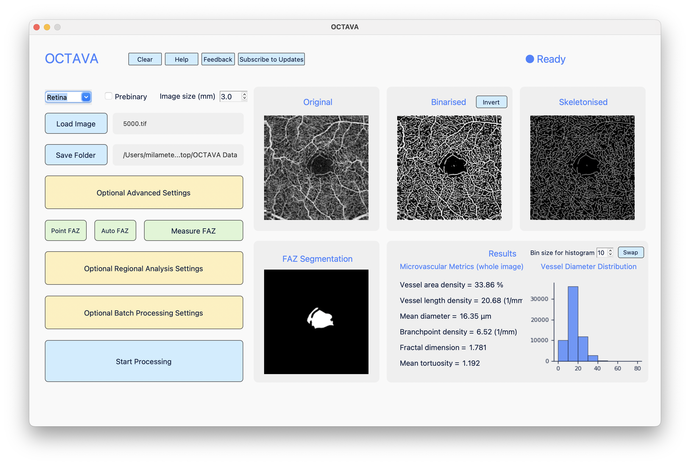

<style>
  a {
    margin-right: 5px;
  }
</style>

<div align="center">
  <h3>
    OCTAVA
  </h3>

<p style="display: flex; justify-content: center;">
  <a href="https://github.com/milanaveed/octava/releases" target="_blank">
    
  </a>

  <a href="https://github.com/milanaveed/octava/releases" target="_blank">
    
  </a>

  <a href="https://github.com/milanaveed/octava/issues" target="_blank">
    
  </a>

  <a href="https://github.com/milanaveed/octava/stargazers" target="_blank">
    
  </a>


  <a href="https://github.com/milanaveed/octava/LICENSE" target="_blank">
    
  </a>
</p>

</div>

This respoitory contains all the sourcecode required to run the OCTAVA software OCTAVA is available free for use under an MIT licence. If you use this software in your research, please cite the following papers:

xxx. https://doi.org/xxx/xxx


| _`OCTAVA` processing OCTA images with binarisation, skeletaization, FAZ segmentation and microvascular analysis_

# Getting Started
## Quick Download
📩 See the latest releases in the [Github Releases](https://github.com/milanaveed/octava/releases) page 📩.
Find the distribution that is suitable for your Operating System (Windows/MacOS/Linux) and Hardware Architecture (X86_64/Arm64). 

_Some distributions (e.g. Windows/Linux on Arm64, MacOS on X86_64) are not available due to limited resources, in this case you can try to install on your own by following the guide down below._

## Build Locally
First `git clone` or download zip from this repository.

### Prerequisites
Install python [3.10.19](https://www.python.org/downloads/release/python-31019/) or compatible versions. 

### One-Line Build
```
python build_executable.py
```

## Develop Locally
For those who read source code for fun or would like to apply your own changes. The following steps describe the process for running the project locally.
Run the following command to install necessary packages:
```
pip install -r requirements.txt
```
**For Conda Users:** ```conda env create -f environment.yml```\
(update as often as possible)

### Post-Installation
Run ```python gui/build/gui.py``` to launch the application