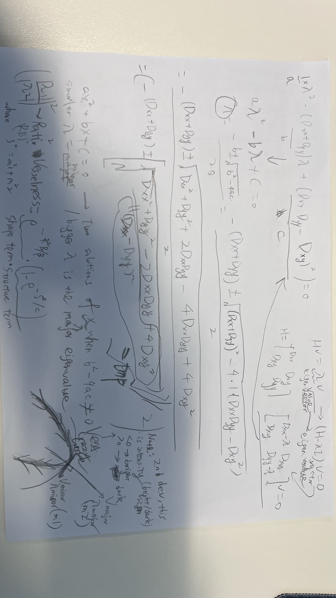

**Current fuzzy binarisation:**
*FRANGI*
⬇   
per sigma (1-4):
second order derivates in x and y direction (Hessian using gaussian derivatives)
⬇
scale by mulitplying sigma^2
⬇
eig2im: Find (major & minor) eigenvalue/eigenvector (after linear transformation e.g. shift, stretch, compression, reflection) -> eigenvector is the vector that does not change direction, eigenvalue is the factor by which the eigenvector is scaled (1 if no scaling)
⬇
Filter out dark vessels by setting the vesselness response to zero for positive eigenvalues in major direction
⬇
Take max across multiple results for each scale (sigma)
*FUZZY*
**normalisation**: normalized image using mean+2std
⬇                                                                         
**denoising**: gaussian conv kernel with kernel_size=11, sigma=1.5 (gaussian bell-curve distribution, heavily weighting the center pixel VS box blur)
⬇
**threshold**: cmeans (two clusters centers of darker vs lighter pixels [0, 1])
⬇
trapezoid membership (4 vertices [a,b,c,d] in a trapezoid to represent [0-1], [1-1], [1-0] ranges), find degree of membership of a pixel to either [0, 1] cluster
e.g. uG(x) = degree of element X belongs to a member of Group G = (x-a)/(b-a) if a < x < b, means partial membership

by setting either ab or cd to the one cluster center and the counterparts cd or ab to the min/max from the smoothed map
find degree to either dark group or light group e.g. [:, :, 0] = 0.2, [:, :, 1] = 0.8
⬇
**cleanup**: median filter with window_size=3
⬇
**normalisation**: argmax on the 3rd axis => argmax([:, :, 0] = 0.2, [:, :, 1] = 0.8) =  1

**TODO**
- justify whether we would use jerman or sato
and if so run loops on combs of params and manually inspect to find if better than frangi

- see if we can find a better denoising than gaussian

- maybe apply histogram CLAHE to to raw image before the pipeline

? OPTIMIZE selection of Frangi filter parameters

**NOTE**
When you finalise the OCTAVA,I would like you to revisit the original experiments and define an optimised and improved approach for vessel segmentation. The attached paper includes several interesting observations and suggestions, particularly regarding the selection of Frangi filter parameters. As illustrated in Figure 5, a similar issue can occur in retinal fundus images and OCTA data, where large vessels may be artificially split into two structures when the Frangi filter settings are not optimal.

**The strongest pipeline for OCTA image segmentation would be:**
denoising:
TODO: med|bilateal->CLAHE->directional or vessel-aware filter or curvelet shrinkage|wavelet-TV| non-local means/BM3D|guided filtering|and directional median filters
⬇
*FRANGI*
multiscale vessel enhancement (current: Frangi | TODO: other hessian filters),
⬇
*FUZZY*
signal normalization (current: inclusive mean+2std then normalize to 0-255 | TODO: none)
⬇
smoothed pts for calculating cluster center (current: gaussian),
⬇
adaptive thresholding (current: global:cmeans+membership | TODO: local?),
⬇
morphology/topology cleanup(current: med with window_size=3 | ),

For **vessel enhancement**, use multiscale Hessian-style filtering, optimally oriented flux, or a hybrid Gabor-Hessian/Frangi-Jerman approach, with scales converted from microns to pixels. 
Large vessels and capillaries should be segmented either in separate channels or separate scale bands, because a single threshold tends to oversegment noise when tuned for capillaries and undersegment capillaries when tuned for large-vessel specificity. 

After enhancement, use **local** adaptive thresholding, such as Sauvola, Phansalkar, local Otsu, or fuzzy C-means, followed by connected-component filtering, spur pruning, and optional skeleton-preserving reconstruction. 
The key to robustness is validation design. Train or tune parameters on scans stratified by device, field size, scan density, plexus, pathology, and signal quality, then report Dice, Jaccard, vessel-density bias, skeleton connectivity, branch-point preservation, and test-retest repeatability. 

**How to efficiently remove noise from OCTA en face images?**
Gaussian blur is usually a poor choice because it reduces grain but also breaks capillaries, widens vessels, shrinks the FAZ boundary, and changes vessel-density estimates.
If you only have a 2D en face image, a good efficient recipe is: crop/mask non-retinal borders, normalize illumination, suppress horizontal or vertical stripe artifacts, apply edge-preserving denoising, enhance vessels, and threshold locally. For speed and reproducibility, *I would use a small median filter or bilateral filter first, followed by CLAHE with conservative clip limits, then a directional or vessel-aware filter*. Directional filtering is particularly attractive in OCTA because vessels are elongated structures; elliptical directional filtering has been shown to improve OCT angiogram quality by matching rotating elliptical kernels to local vessel orientation and applying median filtering in C-scans. If computational time matters, a *2D median or guided filter plus multiscale vesselness* is often faster and easier to deploy than iterative non-local methods.
For traditional denoising choices, I would prioritise methods that preserve thin curvilinear structures: *curvelet shrinkage, wavelet-TV, non-local means/BM3D, guided filtering, and directional median filters*. Wavelet-TV denoising has been used for OCT and projection images because it combines wavelet sparsity with total variation regularization to reduce speckle while preserving layer edges and en face detail. *Curvelet-based* processing is also well suited to vessels because curvelets represent oriented edges and curvilinear structures efficiently, and OCTA microvascular analysis frameworks have used curvelet denoising before vessel enhancement.
My practical recommendation is conservative denoising before thresholding and no heavy smoothing after binarisation. **Use the FAZ or an avascular mask to estimate background noise**, use vessel skeleton continuity as a preservation metric, and tune denoising to minimize false capillary bridges rather than simply maximizing contrast. For publication-grade quantitative OCTA, report the denoising method, kernel sizes, CLAHE settings, threshold method, and whether projection artifacts were removed, because these details can alter vessel-density estimates and repeatability.

**How to find optimal parameters for Frangi, Jerman and Sato settings for retinal OCTA images, and which filter is best?**
The correct way to optimise Frangi, Jerman, and Sato filters is to treat filter settings as study-specific hyperparameters, not universal constants. Their performance depends on pixel spacing, scan field, retinal plexus, capillary diameter, background noise, projection artifacts, contrast normalization, and the target endpoint, such as vessel area, skeleton length, FAZ boundary, or capillary dropout. OCTA studies also show that different vessel-enhancement filters can produce non-interchangeable quantitative results, so the “best” filter must be defined against a validation endpoint rather than by visual appearance alone.

Start by defining the diameter range in physical units. For each scan, convert expected vessel radii into pixels using the instrument’s lateral sampling. For capillary plexus segmentation, test small scales densely; for large-vessel masks, test larger scales separately. A reasonable design is to split the task into two channels: capillary enhancement and large-vessel enhancement, followed by recombination or separate reporting. This avoids forcing one Hessian scale-space filter to handle both very thin capillaries and large superficial vessels.

Next, build a validation set with manual or semi-manual vessel labels across SCP, ICP/DCP, peripapillary scans, macular scans, healthy eyes, and diseased eyes. Optimize parameters with grid search, random search, or Bayesian optimization. The objective function should combine Dice or Jaccard with topology-aware metrics such as skeleton recall, skeleton precision, branch-point preservation, vessel-density bias, FAZ area error, and test-retest coefficient of variation. A filter that gives a beautiful binary image but creates false vessel bridges is not optimal for OCTA, especially in deep plexus and choriocapillaris-adjacent slabs where projection artifacts can mimic vessels.

For Frangi, tune sigma range, sigma step, beta, gamma or c, black/white ridge polarity, and the threshold applied to the vesselness response. Frangi is a strong baseline because it is widely available and interpretable, but it can produce nonuniform responses across vessel diameters and may suppress or distort bifurcations if parameters are not tuned carefully.

For Sato, tune scale range and sensitivity parameters with the expectation that it often behaves like a tubeness detector and can be fast for filament enhancement; ImageJ/Fiji describes Sato-style tubeness as an algorithm for enhancing filamentous structures of specified thickness and notes that it can be a faster alternative to Frangi.
For Jerman, tune scale range and the parameters controlling sensitivity to eigenvalue ratios and structure strength; Jerman was designed to produce a more uniform response across vascular structures, and retinal-vessel literature describes it as responding effectively at vessels, edges, and bifurcations.

If I had to choose one starting filter for retinal OCTA, I would start with Jerman for capillary plexus segmentation because its more uniform vessel response is attractive for mixed thin and thick vessels. I would keep Frangi as the baseline comparator because it is standard, reproducible, and easy to explain. I would use Sato when speed, simple tubeness enhancement, or large-vessel emphasis matters more than fine capillary topology. The final choice should be made empirically on your own OCTA data, and I would not mix filters across cohorts unless the same preprocessing, parameter search, and validation protocol are repeated.